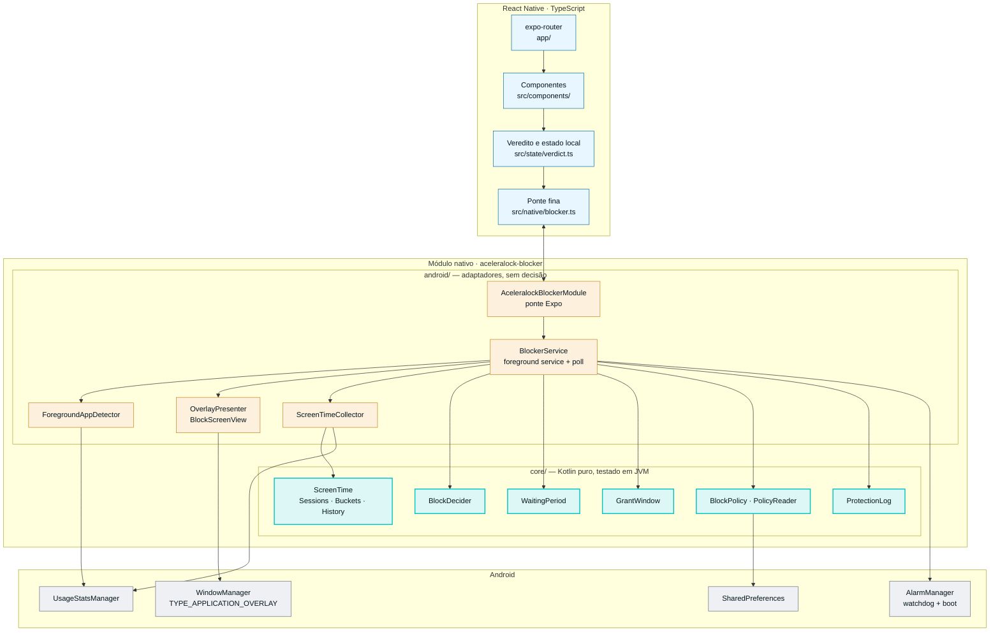
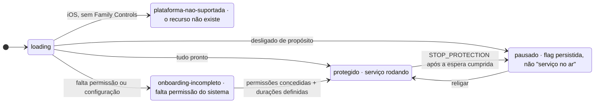
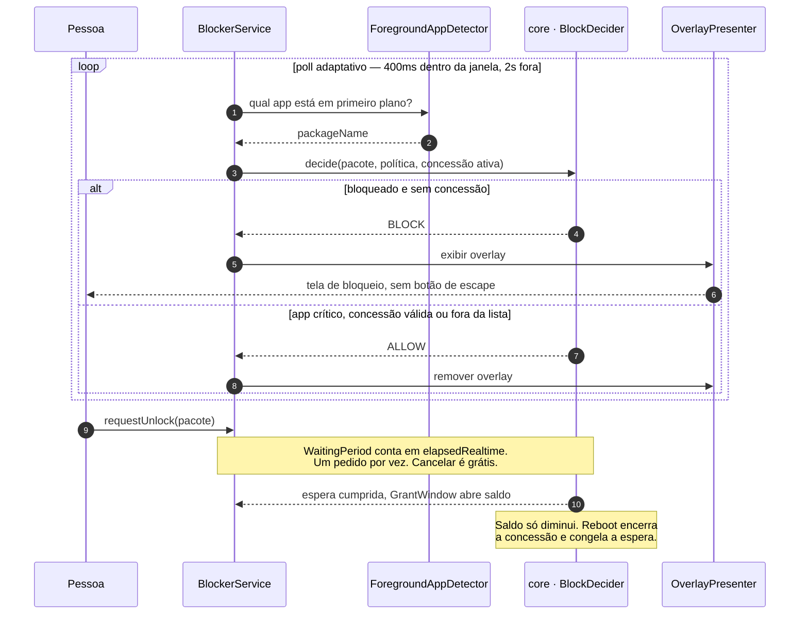

<div align="center">


<h1>AceleraLock</h1>

<br>

**Fricção deliberada entre você e o app que está comendo o seu dia.**

Bloqueio de apps que roda **100% no aparelho** — sem backend, sem cadastro, sem nuvem.

<br>

[](https://github.com/lucasmarujo/AceleraLock/actions/workflows/ci.yml)
[](LICENSE)
[](https://reactnative.dev)
[](https://expo.dev)
[](https://www.typescriptlang.org)
[](https://kotlinlang.org)
[](#estado-atual)

<br>

Um projeto open source construído com a comunidade


</div>

---

## Sumário

- [O problema](#o-problema)
- [As duas restrições que explicam este código](#as-duas-restrições-que-explicam-este-código)
- [Arquitetura](#arquitetura)
- [Stack](#stack)
- [Começando](#começando)
- [Testes](#testes)
- [Estrutura do repositório](#estrutura-do-repositório)
- [Decisões contraintuitivas](#decisões-contraintuitivas)
- [Estado atual](#estado-atual)
- [Marca e design system](#marca-e-design-system)
- [Contribuindo](#contribuindo)
- [Comunidade AceleraDev](#comunidade-aceleradev)
- [Licença](#licença)

---

## O problema

Aplicativos de controle de tempo de tela costumam falhar pelo mesmo motivo: o botão
de desligar fica a um toque de distância. Quando o impulso chega — e ele dura
segundos —, desativar o bloqueio é mais fácil do que resistir a ele.

O AceleraLock ataca exatamente esse ponto. Abrir um app bloqueado não é impossível:
é **caro**.

| Ação | Custo |
| --- | --- |
| Abrir um app bloqueado | Overlay imediato, sem botão de escape |
| Pedir desbloqueio | Espera monotônica acumulada |
| Desligar a proteção | Passa pela **mesma** espera |
| Reduzir a duração da espera | Passa pela **mesma** espera |
| Desistir do pedido | **Grátis** — desistir é o resultado desejado |
| Apps críticos (telefone, emergência) | Nunca bloqueados |

O produto é **fricção, não prisão** — e a diferença é deliberada. Quem usa isto é
alguém que pediu ajuda contra o próprio impulso, não um invasor de quem o app se
defende.

---

## As duas restrições que explicam este código

Sem elas, boa parte do repositório parece rigor gratuito.

### 1. No iOS, o identificador do app nunca sai do aparelho

O Family Controls devolve `ApplicationToken`, e o `bundleIdentifier` é `nil` **por
design** para tudo que vem do `FamilyActivityPicker`. Não é escolha de modelagem: a
plataforma não deixa. É por isso que o alvo de bloqueio é uma referência opaca, e
não um nome de pacote.

### 2. Sem servidor, o relógio do aparelho é do dono do aparelho

Quem quer burlar adianta a hora. Por isso **toda defesa de tempo aqui é
monotônica** — espera e concessão contam `elapsedRealtime`, nunca hora de parede, e
**não existe "instante de fim"** para comparar em lugar nenhum do caminho de
decisão.

### O teto declarado: desinstalar derrota tudo

> [!IMPORTANT]
> **Desinstalar** sempre está disponível e apaga a configuração. **Force-stop** pelas
> Configurações é ainda mais barato: dois toques, e o app entra no *stopped state*,
> onde o Android não entrega mais broadcast nenhum — nem `BOOT_COMPLETED`. A proteção
> fica desligada atravessando reboot, até a pessoa abrir o app de novo.

Não há defesa contra isso sem Device Admin, que foi **vetado**: app que impede a
própria remoção cai em *Deceptive Behavior* do Google Play e, pior, vira malware aos
olhos de quem instalou.

A resposta do produto é **medir e mostrar**, não impedir. Para quem instalou a
ferramenta, um lapso invisível é o que a faz falhar em silêncio; um lapso visível é
exatamente a informação que ela veio buscar.

**Antes de abrir uma issue propondo impedir a desinstalação, leia
[`docs/decisoes.md`](docs/decisoes.md).** A resposta já está lá, com o porquê.

---

## Arquitetura

Três camadas e uma fronteira que importa: **a regra vive em Kotlin puro, testável em
JVM; o que toca o Android é adaptador burro.**



A separação `core/` × `android/` não é cerimônia: o `core` **não importa nada de
Android**, então a regra tem teste de verdade em JVM. O que está em `android/` é
adaptador, e **não tem teste automatizado** — por isso o mínimo possível de decisão
mora lá.

### O veredito decide a tela raiz

[`src/state/verdict.ts`](src/state/verdict.ts) resolve em cinco valores, e
[`app/_layout.tsx`](app/_layout.tsx) mapeia cada um num grupo de rotas.



São cinco e não três porque **cada valor existe para não contar uma mentira**: iOS
não é "permissão pendente", é recurso inexistente; `loading` não é
"onboarding-incompleto"; e `pausado` é quem desligou de propósito, não quem teve o
serviço morto pelo sistema.

### O ciclo de decisão, com o app fechado



---

## Stack

| Camada | Tecnologia | Papel |
| --- | --- | --- |
| App | React Native 0.86 · Expo SDK 57 · New Architecture | UI e navegação |
| Navegação | expo-router (typed routes) | Rotas por grupo de veredito |
| Linguagem | TypeScript 6 | Toda a camada JS |
| Regra de negócio | Kotlin/JVM puro (`core/`) | Bloqueio, espera, concessão, tempo de tela |
| Integração nativa | Expo Modules API · config plugin (CNG) | Ponte e prebuild |
| Persistência | `SharedPreferences` (nativo) · `AsyncStorage` (UI) | A fonte única da política é o nativo |
| Testes | `node:test` + `tsx` · JUnit 5 | 141 testes, zero emulador |
| CI | GitHub Actions | Formatação, lint, tipagem, testes JS e Kotlin |

---

## Começando

### Pré-requisitos

- **Node.js 22+**
- **JDK 17** — o `core` usa `jvmToolchain(17)`
- **Android SDK** e um aparelho ou emulador

> [!WARNING]
> **Expo Go não serve.** O app usa foreground service e overlay do sistema — exige
> `prebuild` e development build.

### Instalação

```bash
git clone git@github.com:lucasmarujo/AceleraLock.git
cd AceleraLock
npm install
```

### Comandos

| Comando | O que faz |
| --- | --- |
| `npm run verify` | Formatação + lint + tipagem + testes JS. **Rode antes de abrir PR.** |
| `npm test` | 73 testes JS puros, sem emulador |
| `npm run typecheck` | `tsc --noEmit` |
| `npm run lint` | ESLint |
| `npm run format` | Prettier |
| `npm run android` | Development build no aparelho ou emulador |
| `npm run prebuild` | Regenera `android/` a partir do config plugin |
| `npm run build:aab` | Prebuild limpo + AAB de release assinado para a Play Console |
| `npm run test:kotlin` | Testes do `core` (exige `gradle` no PATH) |

### Publicando na Play Store

```bash
npm run build:aab
# → android/app/build/outputs/bundle/release/app-release.aab
```

O AAB sai assinado com a **chave de upload** em `credentials/android/upload-keystore.jks`,
com alias e senhas em [`credentials.json`](credentials.json). Os dois são versionados de
propósito: qualquer pessoa do time gera um bundle que a Play aceita. Quem liga a chave ao
build é o config plugin [`native/plugins/withReleaseSigning.js`](native/plugins/withReleaseSigning.js).
Por isso a assinatura sobrevive ao `prebuild --clean`.

> [!IMPORTANT]
> **Suba o `versionCode` em `app.json` antes de cada envio.** A Play recusa um número que
> já recebeu. O `version` vira o `versionName` exibido na loja.

A chave de upload não é a chave que assina o app no aparelho. Essa fica com o Google
(Play App Signing). Se o `.jks` vazar ou for perdido, peça a redefinição da chave de
upload na Play Console (Integridade do app → Assinatura do app).

---

## Testes

| Suíte | Quantidade | Runner | Onde |
| --- | --- | --- | --- |
| JavaScript / TypeScript | **73** | `node:test` + `tsx` | [`tests/`](tests/) |
| Kotlin `core` | **68** | JUnit 5 em JVM | [`core/src/test/`](native/modules/aceleralock-blocker/core/src/test/kotlin/com/aceleralock/blocker/core/) |
| Camada `android/` | — | sem teste automatizado — por isso quase sem decisão | — |

### Rodando o core Kotlin sem `gradle` no PATH

O `core/` é Kotlin puro, tem `settings.gradle.kts` próprio e **não tem `gradlew`**.
Quando o `gradle` não está no PATH, o caminho que funciona é a distribuição que o
wrapper já baixou:

```bash
cd native/modules/aceleralock-blocker
JAVA_HOME="<caminho do JDK 17+>" \
  "$HOME/.gradle/wrapper/dists/gradle-<versão>-bin/*/gradle-<versão>/bin/gradle" \
  :core:test --console=plain
```

> [!NOTE]
> O `build.gradle.kts` do core usa `testLogging { events("failed") }`, então **build
> verde não imprime contagem nenhuma**. Para saber quantos testes rodaram, leia
> `core/build/test-results/test/*.xml` — não confie no console.

---

## Estrutura do repositório

```
app/                        Rotas (expo-router), agrupadas por veredito:
                            (onboarding) · (protected) · (paused) · (unsupported)
src/
  components/               Componentes compartilhados e a lógica pura testável
                            (countdownStatus.ts, tempoTela.ts, passos.ts)
  i18n/                     Idioma do aparelho: 73 catálogos tipados (pt-BR é a
                            fonte), plural CLDR próprio, escolha do idioma
  native/                   Ponte TS fina sobre o módulo nativo
  state/                    Veredito, apps bloqueados, storage do onboarding
  theme/                    Tokens e tema (claro/escuro)
native/
  modules/aceleralock-blocker/
    core/                   Kotlin puro, testado em JVM. É onde mora a regra:
                            decisão de bloqueio, espera, concessão, leitura da
                            política, registro de interrupção, tempo de tela.
    android/                Adaptadores: serviço de poll, detecção de app em
                            primeiro plano, overlay, coleta de uso, ponte Expo.
  plugins/                  Config plugin que liga o core ao prebuild.
assets/
  icon-square-1024.png      Mestre de loja: sangra até a borda, sem alfa. É o
                            `icon` do app.json; iOS e Android arredondam sozinhos.
  icon-1024.png             O mesmo ícone já recortado. Splash nativa, tela de
                            marca, onboarding e overlay — onde o recorte é nosso.
  android/ ios/             Export do design por plataforma: conjunto do Xcode,
                            escada de mipmap, ícone da Play Store e as camadas
                            do adaptive derivadas do ícone.
  aceleradev-logo.svg       Marca da comunidade AceleraDev.
docs/                       Produto, design system, decisões e QA.
tests/                      Testes JS puros (node:test).
assets.old/                 Histórico: marca anterior (mark, wordmark, lockups,
                            favicons). Nada no app aponta pra cá.
backend.bkp/                Histórico: backend Spring Boot e infra Docker/blue-green
                            da arquitetura com servidor. Não roda.
```

---

## Decisões contraintuitivas

Todas com o porquê em [`docs/decisoes.md`](docs/decisoes.md). As que mais confundem
quem chega:

- **Desbloquear exige esperar**, em tempo monotônico acumulado. Impulso dura
  segundos; a espera derrota o impulso, não a pessoa.
- **Um pedido por vez.** Esperas em paralelo fariam a fricção custar trinta minutos
  uma vez, e não uma vez por decisão.
- **Desligar a proteção passa pela mesma espera**, e mudar a duração também. Fricção
  com porta dos fundos é encenação.
- **Cancelar é livre.** Desistir de desbloquear é o resultado desejado; cancelar caro
  empurraria a pessoa a esperar por teimosia.
- **A concessão não é uma lista, é um saldo que só diminui.** Concessão encerrada é
  apagada, não arquivada — guardada, cada liberação já obtida viraria uma chave
  permanente.
- **Reboot encerra a concessão e preserva a espera.** As políticas são opostas pelo
  mesmo critério conservador.
- **Dia sem leitura de tempo de tela é `null`, nunca `0`.** Zero é "não usou o
  celular"; ausência de medição é outra coisa, e mostrar as duas iguais é mentira.
- **O estado ativo é flag persistida**, não "o serviço está no ar" — serviço morto por
  falta de memória diria "pausado" a quem nunca pausou.
- **A fonte única da lista de bloqueados é o nativo.** O serviço decide com o app
  fechado, e o `AsyncStorage` é inalcançável sem JS rodando.

As assinaturas da ponte mudam: leia
[`native/modules/aceleralock-blocker/index.ts`](native/modules/aceleralock-blocker/index.ts)
em vez de confiar numa lista aqui — foi exatamente essa lista que apodreceu na versão
anterior deste README.

### Documentação de referência

| Documento | Conteúdo |
| --- | --- |
| [`docs/decisoes.md`](docs/decisoes.md) | Toda decisão de produto e arquitetura, com o porquê e as dívidas conhecidas |
| [`docs/decisao-modulos-nativos.md`](docs/decisao-modulos-nativos.md) | Por que um módulo próprio em vez de biblioteca pronta |
| [`docs/design-system.md`](docs/design-system.md) | Tokens, contraste WCAG, componentes |
| [`docs/qa/matriz-cenarios-burla.md`](docs/qa/matriz-cenarios-burla.md) | Vetores de burla e o custo de cada um |
| [`docs/qa/roteiro-validacao-aparelho.md`](docs/qa/roteiro-validacao-aparelho.md) | Roteiro de validação em aparelho real |

---

## Estado atual

> [!CAUTION]
> **Nada disto jamais rodou num Android.** Todo o verde deste repositório é regra
> testada em JVM; a integração é território não pisado. A camada `android/` nunca
> compilou uma vez sequer — a primeira `expo prebuild` será a primeira vez que esse
> código existe de verdade.

| Item | Estado |
| --- | --- |
| Regra de bloqueio, espera e concessão (`core`) | ✅ Implementada e testada em JVM |
| Agregação de tempo de tela (`core`) | ✅ Implementada e testada em JVM |
| Onboarding, seleção de apps, telas de espera e perfil | ✅ Implementados |
| CI: formatação, lint, tipagem, testes JS e Kotlin | ✅ Verde |
| Camada `android/` compilando | ⚠️ Nunca compilou |
| Sobrevivência do serviço em fabricante agressivo | ⚠️ Não medida |
| Force-stop verificado em aparelho | ⚠️ Não medido — prioridade máxima quando `android/` compilar |
| `performance.now()` no Hermes | ⚠️ Não verificado em aparelho |
| Build do APK no CI | ⚠️ Desativado. A assinatura existe (`npm run build:aab`), mas o build ainda é local |
| Módulo nativo de iOS | ❌ Não existe — hoje iOS é plataforma não suportada |
| Entitlement Apple para Family Controls | ❌ Não solicitado |

O inventário completo, com o porquê de cada item, está no fim de
[`docs/decisoes.md`](docs/decisoes.md).

---

## Marca e design system

<div align="center">
  
</div>

A marca vive em [`assets/`](assets/): o ícone composto em dois mestres —
`icon-square-1024.png` (sangra até a borda, pras lojas arredondarem) e
`icon-1024.png` (já recortado, pro que o app desenha) — mais o conjunto do Xcode,
a escada de mipmap do Android e o ícone da Play Store. As camadas do adaptive icon
(`assets/android/adaptive/`) são derivadas do próprio ícone: a mesma arte a 72% com
o degradê replicado até a borda, pra máscara do launcher cortar degradê e nunca o
cadeado. A marca anterior ficou em [`assets.old/`](assets.old/) e não é mais
referenciada.

Os tokens de cor estão em [`src/theme/tokens.ts`](src/theme/tokens.ts), com contraste
revalidado contra WCAG e coberto por teste. A regra é do sistema, não coincidência de
hex: **o primário é sempre a cor que contrasta com o canvas do tema, e o rótulo é
sempre a oposta.**

> [!NOTE]
> O overlay nativo tem recurso de cor próprio no Android: mudar cor de marca em
> `tokens.ts` exige tocar o `colors.xml` do módulo na mesma passada — não há lint que
> alcance isso.

---

## Contribuindo

Contribuições são bem-vindas — issues, PRs e discussões.

- **Conventional Commits** (`feat:`, `fix:`, `docs:`, `test:`, `refactor:`, `chore:`,
  `build:`, `ci:`), com escopo quando ajudar e `BREAKING CHANGE:` no rodapé quando o
  contrato quebrar.
- **Toda implementação vem com teste.** No `core`, JUnit 5 com `@DisplayName`
  descrevendo o cenário em português — categoria e comportamento, não o nome do
  método. No JS, `node:test` puro.
- **Regra em Kotlin puro, adaptador burro.** Se a decisão der para testar em JVM, ela
  pertence ao `core`.
- **`npm run verify` verde antes de abrir PR.** É o mesmo conjunto que o CI roda.
- **Leia [`docs/decisoes.md`](docs/decisoes.md) antes de desfazer algo que pareça
  estranho.** Boa parte do que parece rigor gratuito é consequência das duas
  restrições do topo.

---

## Comunidade AceleraDev

<div align="center">
  
</div>

O AceleraLock é um projeto aberto construído junto com a comunidade **AceleraDev** —
pessoas desenvolvedoras trocando código, revisão e experiência de verdade. Cada
decisão deste repositório está documentada justamente para que qualquer pessoa da
comunidade consiga entrar, entender o porquê e contribuir sem precisar adivinhar.

Se você chegou por aqui pela comunidade: comece por
[`docs/decisoes.md`](docs/decisoes.md), rode `npm run verify` e pegue um item da
tabela de [Estado atual](#estado-atual).

---

## Licença

[MIT](LICENSE) © 2026 Lucas Marujo

<div align="center">
<br>
<sub>Feito com a comunidade AceleraDev · <b>Fricção, não prisão.</b></sub>
</div>
